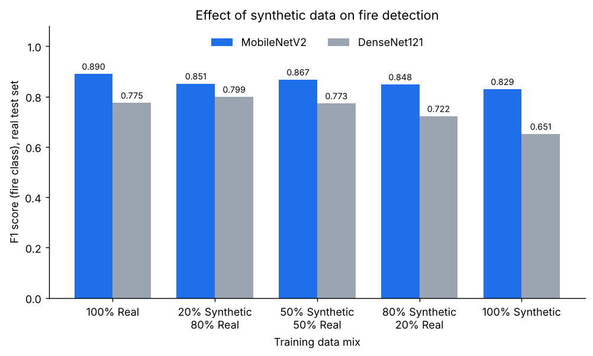

# Synthetic Data for Industrial Fire Detection

MSc project, University of Bristol (Faculty of Engineering, Department of Engineering Mathematics, 2025): **Optimising Synthetic Data Use in AI for Industrial Fire Detection**.

Real fire images are scarce, hard to label and risky to capture in industrial settings. This project measures how far **synthetic** images can replace or supplement real ones when training a fire / no-fire image classifier, by training on five synthetic-to-real mixes and testing every model on **real** images only.

## Approach

- **Task:** binary image classification (fire vs no fire) at 224 x 224 resolution.
- **Models:** MobileNetV2 (lightweight) and DenseNet121 (heavier), both with ImageNet weights, a frozen backbone and a single sigmoid output layer, trained with Adam and binary cross-entropy.
- **Training mixes:** 100% real, 20% synthetic / 80% real, 50 / 50, 80% synthetic / 20% real, and 100% synthetic.
- **Evaluation:** always on the held-out real test set: accuracy, precision, recall and F1 for the fire class, plus confusion matrices and misclassified examples.

## Results

F1 score for the fire class on the real test set:

| Training mix | MobileNetV2 | DenseNet121 |
| --- | --- | --- |
| 100% real | **0.890** | 0.775 |
| 20% synthetic / 80% real | 0.851 | **0.799** |
| 50% synthetic / 50% real | 0.867 | 0.773 |
| 80% synthetic / 20% real | 0.848 | 0.722 |
| 100% synthetic | 0.829 | 0.651 |



- **Synthetic-only is usable but weaker.** Training on synthetic images alone reaches an F1 of 0.829 with MobileNetV2 and 0.651 with DenseNet121 on real test images.
- **Mixing recovers most of the gap.** With MobileNetV2, a 50 / 50 mix is within 0.023 F1 of real-only training.
- **The lighter model transfers better here.** MobileNetV2 scores higher than DenseNet121 in every mix. DenseNet121 is the only model that improves on its real-only score, with a 20 / 80 mix (0.799 vs 0.775).

Full metrics (accuracy, precision, recall, F1) are in [`results/`](results). Each figure comes from a single training run, so small differences should not be over-interpreted.

## Repository layout

```
.
├── notebooks/fire_detection_experiments.ipynb   Data pipeline, training and evaluation for both models
├── results/
│   ├── mobilenetv2_metrics.csv
│   └── densenet121_metrics.csv
├── src/plot_results.py                          Draws the results chart
├── docs/f1-by-training-mix.png
└── requirements.txt
```

## Data

Neither dataset is redistributed here because of licensing. Download them and place them under `data/` (or any folder, then set `FIRE_DATA_ROOT`):

- **Real:** [D-Fire dataset](https://github.com/gaiasd/DFireDataset)
- **Synthetic:** [Synthetic Fire-Smoke (Roboflow Universe)](https://universe.roboflow.com/yunnan-university/synthetic-fire-smoke)

Expected layout:

```
data/
├── real/
│   ├── train/{images,labels}
│   └── test/{images,labels}
└── synthetic/
    ├── train/   (+ Labels.txt)
    ├── valid/   (+ Labels.txt)
    └── test/    (+ Labels.txt)
```

Real images are labelled fire when their YOLO label file is non-empty and no fire otherwise.

## Run it

Requires Python 3.10 or newer.

```bash
git clone https://github.com/Mounish16/synthetic-data-fire-detection.git
cd synthetic-data-fire-detection
python -m venv .venv
source .venv/bin/activate
pip install -r requirements.txt
jupyter notebook notebooks/fire_detection_experiments.ipynb
```

To use a different data folder, run `export FIRE_DATA_ROOT=/path/to/data` before starting Jupyter. Training is faster on a GPU. To regenerate the results chart, run `python src/plot_results.py`.

## Limitations

- Results come from one run per configuration, without confidence intervals.
- The backbone is frozen, so the study measures feature transfer rather than full fine-tuning.
- Validation during training uses the synthetic validation split.
- The notebook is an experiment log; its sections are not yet separated into reusable modules.

## Citation

```bibtex
@misc{satheesh2025fire,
  author       = {Mounish Pothappi Satheesh},
  title        = {Optimising Synthetic Data Use in AI for Industrial Fire Detection},
  year         = {2025},
  publisher    = {University of Bristol},
  howpublished = {\url{https://github.com/Mounish16/synthetic-data-fire-detection}}
}
```

## License

Code is released under the [MIT License](LICENSE). The datasets are subject to their own licences.
